# Fault Diagnosis | A Small Innovation: Feature Extraction + KAN Classification

(1) Bearing Fault Diagnosis Model Based on KAN and Convolutional Kernels
(2) Super-strong Machine Learning Recognition Model Based on Feature Extraction of Fault Signals
Preface
This paper is based on bearing data from Case Western Reserve University (CWRU), employing feature extraction and the KAN model for fault detection, and conducts a comparative analysis with CNN-SENet, MLP, and traditional machine learning models such as SVM. For detailed introductions to feature extraction and the KAN model, please refer to the following text.
Python-Case Western Reserve University (CWRU) Bearing Data Interpretation and Classification Process
| SHAP model visualization + parameter search strategy in bearing fault diagnosis based on KAN and KAN convolution
Comparative analysis of results:
Comparative experiments have shown that:
After feature extraction, the accuracy of KAN is superior to CNN-SENet, MLP and traditional machine learning model SVM!
\tThe code data is as follows:
(1) KAN, KAN convolution, KAN, KAN convolution combined with attention mechanism
\t  
(2) Feature Extraction + Machine Learning Models, \tSHAP Model Visualization and Parameter Search
\t  
1. Dataset and feature extraction
1.1 Dataset Import
Refer to the previous article for preprocessing of fault classification 10, and the Case Western Reserve University bearing data set: Classification 10 dataset.
Data reading format and preprocessing ideas
1.2 Failure Signal Feature Extraction
\t  
13 indicators such as kurtosis, entropy, fractal value, waveform index, spectral index, frequency domain index, statistical feature, vibration feature are selected to capture the multi-scale characteristics of bearing signals for training and recognition of machine learning models.
2. Fault Diagnosis Model Based on KAN
\t2.1 Define the KAN model
2.2 Parameter settings and model training
3. Model Evaluation and Visualization
\t3.1 Model Scores, Accuracy, Precision, Recall, F1 Score
\t3.2 Confusion Matrix for Classification of Faults
\t3.3 t-SNE Feature Visualization
\t (1)Original Data t-SNE Feature Visualization
\t (2)t-SNE Feature Visualization after Model Training:
\t
Click to download: Full original data, Python code
Previously Interesting Content:
Python - Analysis and Classification of Bearing Data from Case Western Reserve University (CWRU)
Python Bearing Fault Diagnosis (Part I): Short-Time Fourier Transform STFT
Python Bearing Fault Diagnosis (Part II): Continuous Wavelet Transform CWT
Conclusion
\t2. Friends who like this can click to follow, give the article a "like", share on WeChat Moments or discuss in groups

## Images

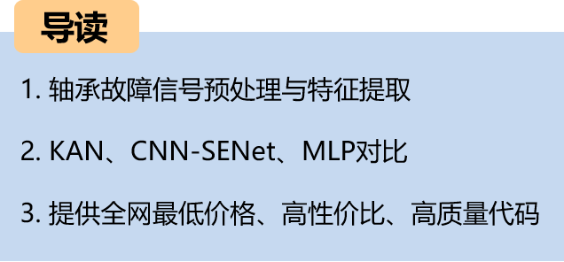
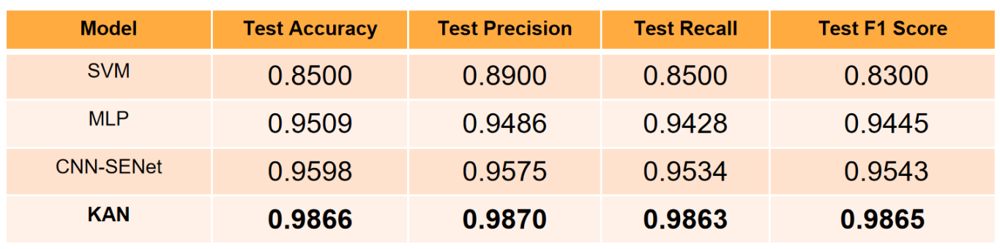

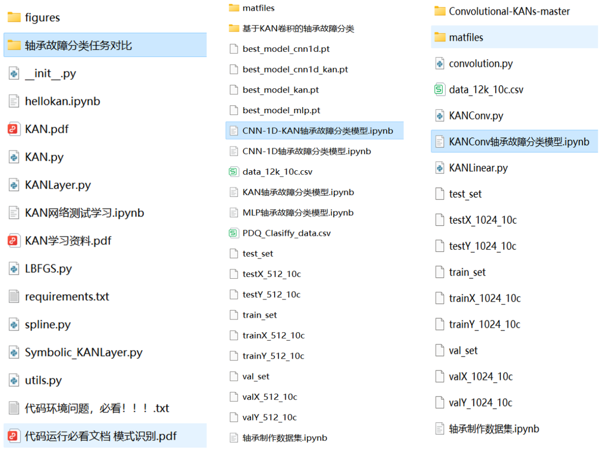
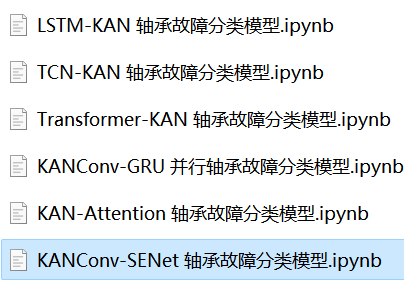
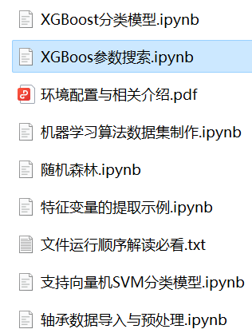

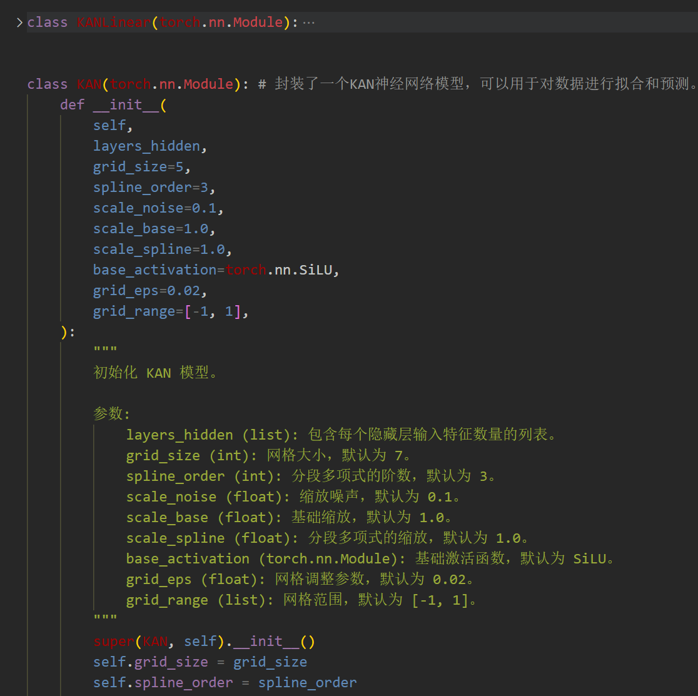
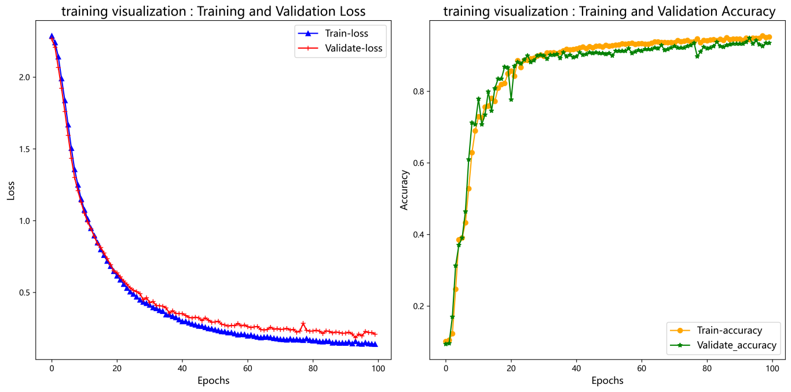
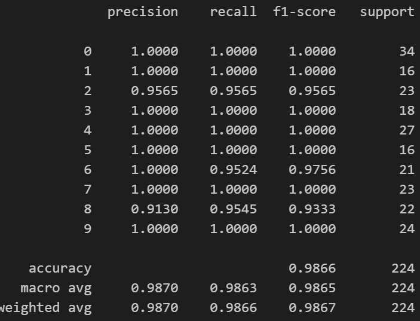
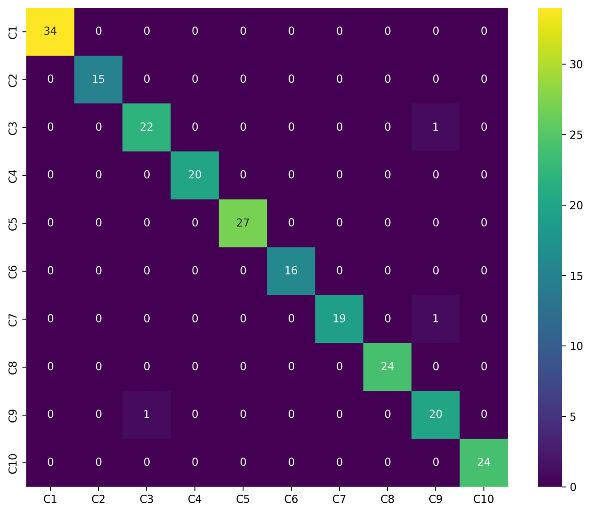
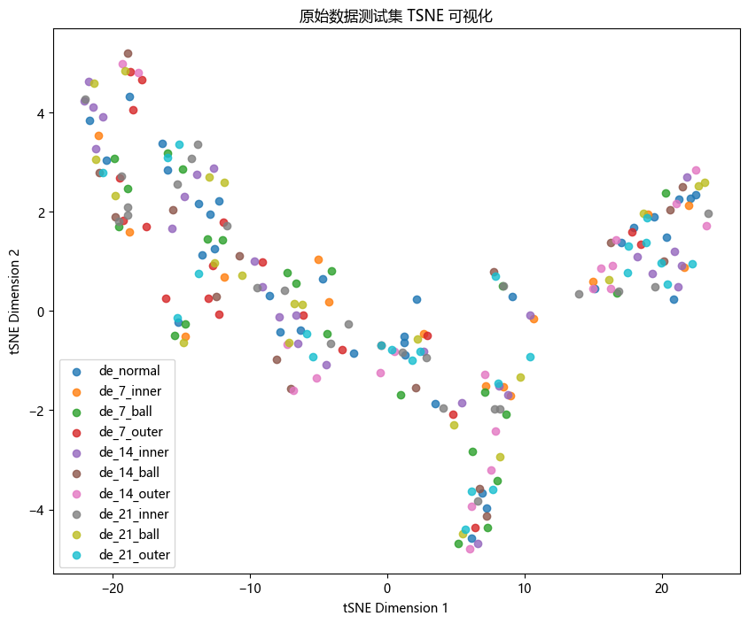
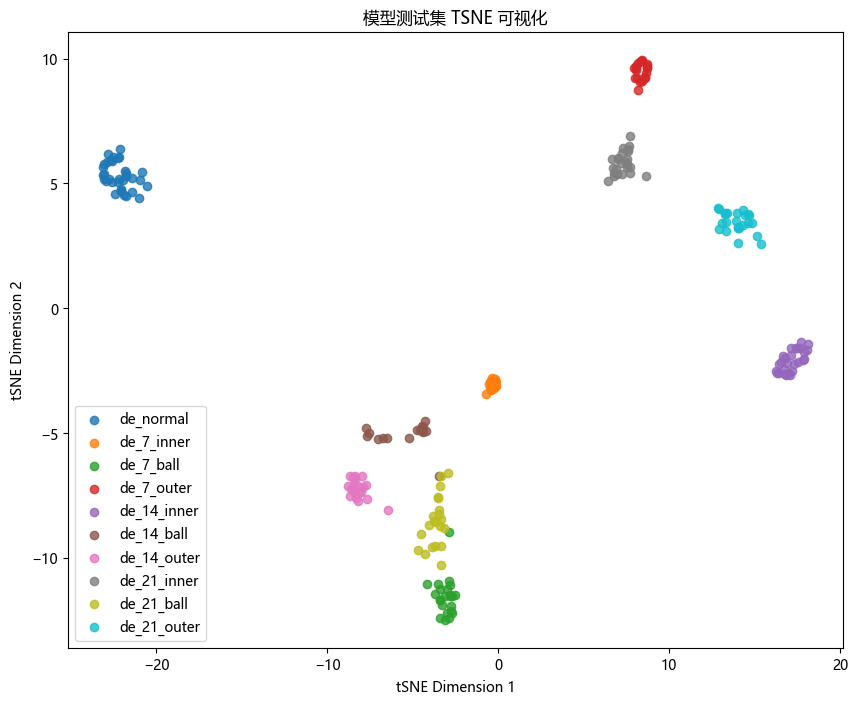

<!-- PAYMENT_BLOCK -->

## Get this dataset

- Payment link (Stripe): [Buy now](https://buy.stripe.com/3cs8yP7sY87d0vu9AB)
- Payment QR code: 

<!-- /PAYMENT_BLOCK -->
